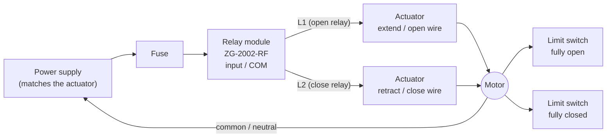

<div align="center">


<br>

**Automatic tilt control for solar panels on linear actuators. Helios Tilt works out where the sun is, picks the best angle for each panel, and drives your actuator to it. When the wind picks up it stows the panels first.**

[](https://my.home-assistant.io/redirect/hacs_repository/?owner=DonTranQuiL&repository=helios-tilt&category=integration)
[](https://my.home-assistant.io/redirect/config_flow_start/?domain=helios_tilt)

[](https://github.com/DonTranQuiL/helios-tilt/releases)
[](https://hacs.xyz)
[](https://www.home-assistant.io/)
[](LICENSE)

[](https://github.com/DonTranQuiL/helios-tilt/actions/workflows/pytest.yml)
[](https://github.com/DonTranQuiL/helios-tilt/actions/workflows/hass-ci.yml)
[](https://github.com/DonTranQuiL/helios-tilt/actions/workflows/hassfest.yaml)
[](https://github.com/DonTranQuiL/helios-tilt/actions/workflows/hacs.yaml)
[](https://github.com/DonTranQuiL/helios-tilt/actions/workflows/codeql.yml)
[](https://github.com/astral-sh/ruff)
[](https://discord.gg/qaHPTTKHae)
[](https://ko-fi.com/DonTranQuiL)
[](https://liberapay.com/Malosaaa/donate)
[](https://liberapay.com/Malosaaa/donate)

[Dumb actuators](#works-with-dumb-actuators-two-relays-timed) · [Calibration](#time-the-travel-required) · [ZG-2002-RF example](#example-tuya-zg-2002-rf-via-zigbee2mqtt) · [How the angle is chosen](#how-the-angle-is-chosen) · [Safety](#safety) · [Customization](#customization) · [Install](#installation) · [Entities](#entities) · [Card](#dashboard-card) · [FAQ](#faq) · [Docs site](https://dontranquil.github.io/helios-tilt/)

</div>

Helios Tilt is a Home Assistant integration that sets the tilt of solar panels (or a roof window, or anything else on a linear actuator) from the real sun position, and protects it against wind, storms, snow, rain and frost. It runs entirely locally, needs no extra Python packages, and ships with its own dashboard card.

## Highlights

| | |
| --- | --- |
| 🔌 **Works with dumb actuators** | Two cheap relays (for example a **Tuya ZG-2002-RF** via Zigbee2MQTT) are enough: time-based position estimate, interlock, a hardware countdown fail-safe, automatic homing against the limit switches, RF-remote detection and offline handling. [Read more](#works-with-dumb-actuators-two-relays-timed). |
| ☀️ **Real sun position** | The NOAA solar position algorithm with refraction, computed locally. No cloud service. |
| 📐 **Four strategies** | Fixed annual optimum, a seasonal curve, one move per day to the day's optimum, or full sun tracking with a cloudy-day mode and a night park. |
| 🌬️ **Safety first** | Wind and gust stow with a calm period, a latching storm mode, snow/rain/frost positions, custom stow triggers and an optional wind direction rule. |
| 🎛️ **Customizable** | Your own rain, snow and temperature sensors, quiet hours, a timed stow, and transparent attributes that show which source drives each decision. |
| 🔩 **Any actuator** | Also drives a `cover`, a `number`/`input_number` or a script, with linear or calibration-table mapping, and position or inclinometer feedback. |
| 🛡️ **Gentle on the hardware** | Never commands a moving actuator. Minimum time between moves, deadband, hysteresis, fault back-off and a repair notice when an actuator gets stuck. |
| 🃏 **Dashboard card included** | Side view with the sun, wind gauge, Auto/Stow/Manual, an angle slider, today's plan, the last moves, and badges for relay offline, uncertain position and quiet hours. |

<div align="center">

<br><sub>The bundled card, rendered from <b>demo data</b> (two simulated panels).</sub>
</div>

## Works with dumb actuators: Two relays (timed)

Most linear actuators and window openers are "dumb": a motor, two internal **limit switches** that stop it at each end, and no position feedback at all. Helios Tilt drives them with **two relays**, one to extend (open) and one to retract (close), and keeps track of the position itself. This is tested on a real Tuya **ZG-2002-RF** dual relay driving an attic window opener.

### How it works

- **Time-based position estimate.** The stroke position (0–100 %) is computed from how long each relay has been on, with **separate open and close times** (actuators are often faster one way) and an optional start delay. The end angles map the stroke to the panel angle (linearly, or with a calibration table for non-linear mounts). The estimate is saved, so a restart keeps it.
- **Homing against the limit switches.** Any run to 0 % or 100 % keeps going for an extra *homing overrun* (15 % of the travel time) so the actuator is certainly at its limit switch; that resets the estimate exactly. Helios also homes on the first move after setup, after a restart that interrupted a run, after a fault, every *N* moves (20), and before the night park. Until then the position is marked **uncertain**.
- **Interlock.** Before a relay switches on, the other one is switched off and its state confirmed, then Helios waits at least 0.3 s (1 s after a run the other way). If a relay doesn't confirm within 5 s, or both are ever on together, both are switched off, the position is marked uncertain and a repair notice appears. No run lasts longer than the full travel time + the homing overrun + 5 s.
- **Relay countdown fail-safe.** If you give it the relay's countdown entity, Helios arms it for every run (run time + 2 s), so the relay switches itself off even if Home Assistant crashes mid-run. Tuya countdowns *toggle* the relay when they expire, so Helios arms it only after the relay is confirmed on and clears it after every run.
- **RF remote and manual operation.** Switching the relays with the RF remote, a wall switch or the Zigbee2MQTT frontend is detected. Helios follows the run in its estimate (capped at the maximum run) and pauses automatic control like any manual move. Switching a relay off during a Helios run stops the run there.
- **Relay offline.** Before every run Helios checks that both relays (and countdowns) are available. While one is `unavailable` (Zigbee device offline), it switches nothing, logs it once, raises a *relay offline* repair, sets *Actuator available* to off and shows **Relay offline** on the card. When the device is back, everything clears and the panel drives to its target by itself.
- **Fault back-off.** After a relay fault, automatic moves wait 1, 2, 4 … up to 30 minutes instead of retrying every round. Wind and storm stows still interrupt any run, including homing and calibration.

### Wiring



```
 PSU ──► FUSE ──► relay COM ──┬── L1 (open)  ──► actuator EXTEND/OPEN wire  ─┐
                              └── L2 (close) ──► actuator RETRACT/CLOSE wire ─┤
                                                                              ▼
                           actuator: motor + internal limit switches (open end, closed end)
                                                                              │
 PSU ◄──────────────────────────── common / neutral ◄─────────────────────────┘
```

This is the usual wiring for openers with a common wire and separate open and close wires (as on most window and AC actuators). A plain two-wire **DC** actuator reverses by **swapping polarity**: wire the two relays as an H-bridge or use a DPDT/changeover relay pair, as the actuator's manual shows, so both directions can never short the supply. In every case the actuator's own limit switches must stop it at both ends; Helios relies on them for homing.

### Time the travel (required)

The position estimate is only as good as the travel times. **Time the travel once after setup**, and again if you change the mount or the supply voltage.

1. Enter the panel angle at both ends: *Panel angle when fully closed / open*.
2. On the integration page open the panel's **⋮ → Reconfigure → Time the travel (calibrate)**.
3. Enter a *homing time* that's long enough to close fully from anywhere, and submit. The actuator closes fully, pauses, then starts opening.
4. Press **Submit** the moment it stops at the **fully open** end. It then closes again: press **Submit** the moment it stops at the **closed** end. (Pressing too early just tells you it's still moving.)
5. Check the measured open and close times, adjust the end angles if needed, and save.
6. Press **Home now** and check that it closes fully. Then test the stow angle and a wind stow while you watch (set a test wind sensor above the stow speed).

No dialog? Use the panel's buttons **Travel calibration: start / end reached / cancel** (configuration entities), or the action `helios_tilt.calibrate_travel` with `action: start | stop | cancel`. You can also type the times in by hand: use a stopwatch from the moment it starts moving until it stops. While calibrating, the strategy makes no moves; wind and storm still cancel the calibration and stow. Closing the dialog cancels the run and switches both relays off.

> [!TIP]
> - In Zigbee2MQTT set **`power_on_behavior_l1` and `_l2` to `off`**, so a power cut never restarts the motor.
> - **Inching** (auto-off) on the module: either **disable** it, or set `inching_time_1/2` **above the longest run: full travel time × 1.15 + 5 s**. A shorter inching time cuts homing runs short and the estimate drifts.
> - **Find the entity names** on the device page in Home Assistant (**Settings → Devices → your relay**). They follow the friendly name you gave the device in Zigbee2MQTT.
> - **Fuse the supply** and keep the actuator's limit switches; never rely on software alone.

### Example: Tuya ZG-2002-RF via Zigbee2MQTT

Replace `<name>` with your device's name in Zigbee2MQTT (e.g. `attic_window`).

| Zigbee2MQTT | Home Assistant entity | Helios field |
| --- | --- | --- |
| `state_l1` | `switch.<name>_l1` | **Open relay (extends)** |
| `state_l2` | `switch.<name>_l2` | **Close relay (retracts)** |
| `countdown_l1` | `number.<name>_countdown_l1` | **Open relay countdown** |
| `countdown_l2` | `number.<name>_countdown_l2` | **Close relay countdown** |
| `power_on_behavior_l1/_l2` | `select.<name>_power_on_behavior_l1/_l2` | not used by Helios: set both to **off** |

A complete panel, as used on a real attic window (closed 10°, open 40°):

| Step | Field | Value |
| --- | --- | --- |
| 1 | Panel name | `Attic window` |
| 1 | Actuator type | **Two relays (timed)** |
| 2 | Open relay / Close relay | `switch.<name>_l1` / `switch.<name>_l2` |
| 2 | Open / close relay countdown | `number.<name>_countdown_l1` / `number.<name>_countdown_l2` |
| 2 | Full open time / full close time | from [Time the travel](#time-the-travel-required) (start with a stopwatch value) |
| 2 | Panel angle when fully closed / open | `10` / `40` |
| 2 | Axis, azimuth | `tilt`, the direction the window faces (180 = south) |
| 2 | Minimum / maximum angle | `10` / `40` |
| 2 | Step, strategy | `5`, `daily` (or `tracking` / `seasonal`) |
| 2 | Homing (collapsed) | defaults: overrun 15 %, direction pause 1 s, home after 20 moves, home against *closed* |
| 3 | Stow angle | `10` (closed), and the other positions within 10–40 |

Then time the travel, press **Home now**, and add the card.

## How the angle is chosen

Every minute, and whenever a relevant entity changes, Helios runs one decision round per panel. The first rule that applies wins: **safety > manual > automatic**.

| Priority | Rule | Panel goes to |
| --- | --- | --- |
| 1 | **Storm mode** or **wind stow** | stow angle, immediately |
| 2 | **Custom stow trigger** on | trigger angle (or stow angle), immediately |
| 3 | Stowed with the **Stow** action (optionally for a duration) | stow angle |
| 4 | **No valid wind data** (start-up, or stale) | stays put; stays stowed if the last wind was high |
| 5 | **Snow / heavy rain / frost** (if enabled) | snow / rain / frost angle |
| 6 | **Manual mode** | your manual angle |
| 7 | **Paused** after a move by hand | stays put |
| 8 | **Automatic control off** | stays put |
| 9 | **Quiet hours** | stays put (the night park still happens) |
| 10 | **Strategy** | see below |

### Strategies

- **Daily** (default): each day, the single angle that collects the most clear-sky energy that day. One move in the morning, then rest. Ideal for slow actuators and relays.
- **Tracking:** at every round, the angle that catches the most clear-sky light right now (direct sun plus sky light, so a touch flatter than pointing straight at the sun). Under heavy cloud (above the cloud threshold) it goes to the flatter *diffuse* angle. After sunset it goes to the *night park* angle.
- **Seasonal:** a smooth curve between your *winter* angle (at the winter solstice) and your *summer* angle (at the summer solstice). The suggested values are latitude + 15° and latitude − 35°; the *season weight* leans the curve.
- **Fixed:** the best single angle for the whole year at your location, computed once at start-up.

The raw angle is clamped to the panel's **soft limits** and rounded to the **step**; **hysteresis**, a **deadband** and a **minimum interval** between moves prevent hunting. Safety moves and your own actions go through immediately.

### Why the panel sits at its maximum angle in autumn and winter

The angle is measured from horizontal: 0° is flat, 90° is vertical. A low sun needs a **steep** panel. At Dutch latitudes (52° N) the best daily angle for a south-facing panel is roughly:

| Date | 21 Jun | 15 Aug | 22 Sep | 10 Oct | 15 Nov | 21 Dec |
| --- | --- | --- | --- | --- | --- | --- |
| Daily optimum | 14° | 30° | 49° | 58° | 70° | 75° |

The best fixed angle for the whole year is about 40°. So from about September to March, the optimum is steeper than most mounts allow, and **tracking, daily and seasonal all clamp to your maximum angle**. That's expected: the maximum is simply the best the mount can do. With a 10–40° window, expect 40° from early September to early April, and lower angles only from spring to late summer.

**Axis.** A *tilt* rack leans toward its azimuth. A *roll* tracker is a single-axis tracker; its azimuth is the direction of positive tilt, and negative angles tilt the other way.

The **estimated gain** sensor compares today's modelled clear-sky energy at the angles the panel actually held with the same panel fixed at its annual optimum. Only time spent following the strategy counts (`excluded_minutes` shows the rest). With a PV power sensor and peak power you also get **PV actual vs model**.

## Safety

- **Wind stow:** wind is the highest of the weather entity's `wind_speed`, its `wind_gust_speed`, and your wind sensor, all converted to km/h. At the **stow speed** (50 km/h) every panel stows at once.
- **Resume:** only after the wind has stayed at or below the **resume speed** (35 km/h) for the **calm time** (10 min).
- **Storm mode:** at the **storm speed** (75 km/h), or with `helios_tilt.stow` and `storm: true`, the site latches into storm mode for the **hold time** (6 h) after the last strong wind (0 = until you resume by hand). Storm mode always moves, regardless of quiet hours or the wind direction rule.
- **Missing data:** without fresh wind data (older than 120 min) panels freeze; if it was windy, they stay stowed. After a restart nothing moves until valid wind data arrives. The config flow refuses a setup without a wind source.
- **Actuator protection:** never commands a moving actuator; a repair notice appears when an actuator doesn't reach its target.

> [!TIP]
> **Use a weather entity that reports gusts.** Gusts, not the average wind, are what bend mounts. Some weather entities (for example the weather of an alarm or security system) only report an average `wind_speed`. A provider with `wind_gust_speed`, such as **Buienradar** (Netherlands/Belgium) or Met.no, or a local anemometer, protects much better. The *Wind stow* and *Storm mode* sensors show `weather_wind`, `weather_gust`, `sensor_wind` and `wind_source` (which one drives the value right now). An empty `weather_gust` means your weather entity has no gusts.

### Mechanical safety

> [!CAUTION]
> Helios Tilt is software. It can't see your mount, and Home Assistant can crash, lose Wi-Fi or be updated at the wrong moment.
> - Use actuators with **hardware end stops** or limit switches, and fuse their supply.
> - Set the soft limits inside the mechanical range, and **test the stow angle** for your mount and local wind loads.
> - For storm protection that never depends on Home Assistant, add a local fallback in the actuator controller, such as an ESPHome anemometer that stows on its own.
> - Keep people and pets clear of moving mounts. Use this integration at your own risk (MIT licence, no warranty).

## Customization

All of these are optional and live in collapsed sections under the site's **Configure**.

### Your own sensors

Each one overrides the weather entity while it has a value, and falls back to the weather condition when it is unavailable.

| Sensor | Accepts | Notes |
| --- | --- | --- |
| Rain | a binary sensor (on = heavy rain), or a precipitation rate | mm/h, mm/d, in/h or in/d, compared with *Heavy rain from* (5 mm/h). Needs *Heavy rain position* on. |
| Snow | a binary sensor (on = snow), or a snow depth | mm, cm, m, in or ft, compared with *Snow from depth* (1 cm). |
| Outdoor temperature | a temperature sensor | Used for the frost threshold; °F is converted. |

A sensor with an unknown unit is ignored, with a warning in the log.

### Custom stow triggers

Pick any entities (binary sensors, input booleans, switches …). While **any** is `on`, every panel goes to the *trigger stow angle* (or its own stow angle), immediately and with safety priority. The reason and the card name the trigger, e.g. *Stow trigger (Hail warning)*. When all are off, the panels resume at once. Ideas: a hail warning, `input_boolean.window_cleaning`, a roof-access door.

For a one-off stow, `helios_tilt.stow` takes an optional `duration` and resumes by itself afterwards.

### Quiet hours

A start and end time; the window may cross midnight (22:00–07:00 works). During quiet hours the strategy holds the panels: the target's `reason` is `quiet`, `detail` says *until 07:00*, and the card shows a **Quiet hours** badge.

- The **night park still happens** (tracking strategy): parking at sunset is a single move and the panel then rests all night.
- Your own commands (set tilt, stow, resume) still move.
- *Allow safety moves in quiet hours* is **on** by default. Turn it off to hold wind, trigger, snow, rain and frost moves too. **Storm mode always moves.**

### Wind direction rule (off by default)

Side wind hardly loads a tilted panel; wind on its face or underside does. With the rule on, a wind stow only happens when the wind comes from within ± *sector width* (60°) of the panel's front (its azimuth) and/or rear (azimuth + 180°).

- Direction comes from the weather entity's `wind_bearing`, or a *wind direction sensor* (degrees, or N/NE/SSW …) which wins when it has a value.
- **No direction known → every panel stows**, as without the rule.
- **Above the storm speed every panel stows**, whatever the direction.
- An exempt panel still follows snow, rain and frost; its target has `wind_exempt: true`.

Example: a south-facing panel, both sides, ±60°: wind from 120°–240° or 300°–60° stows; an east or west wind doesn't.

## Installation

### HACS (recommended)

Helios Tilt is in the **HACS default list**, so no custom repository is needed:

1. Open **HACS** and search for **Helios Tilt** (or click **Open in HACS** above).
2. Download **Helios Tilt** and restart Home Assistant.
3. **Settings → Devices & services → Add integration → Helios Tilt.**

<details>
<summary>Fallback: add as a custom repository</summary>

If Helios Tilt does not show up in the HACS search yet, go to HACS → ⋮ → **Custom repositories**, add `https://github.com/DonTranQuiL/helios-tilt` as type *Integration*, then continue with step 2.

</details>

### Manual

Copy `custom_components/helios_tilt` into your `config/custom_components/` folder and restart.

### Setup

1. **Site:** a name, the location (defaults to your Home Assistant location), and a **weather entity** (preferably with gusts) and/or a **wind speed sensor**.
2. **First panel**, in three short steps:
   1. A name and the **actuator type**: *Entity (cover, number or script)* or *Two relays (timed)*.
   2. Only that type's settings, plus the axis, azimuth, soft limits, step and strategy.
   3. The positions (stow, night, diffuse, snow, rain, frost) and the seasonal angles (suggested from your latitude), plus the optional PV comparison. All angles stay within the soft limits.
3. Two relays: **[time the travel](#time-the-travel-required)**.
4. More panels: **⋮ → Add panel**. Change a panel: **⋮ → Reconfigure**.
5. **Configure** on the site holds the thresholds and the [customization](#customization) sections; **Reconfigure** changes the location and weather sources.

### Actuator mapping

Helios Tilt thinks in panel angles; your actuator thinks in positions.

- **Linear:** *position at minimum angle* and *position at maximum angle*. For a cover these are usually 0 and 100. Swap them for an actuator that extends to flatten the panel.
- **Calibration table:** for the non-linear geometry of a strut pushing a hinged panel. Measure a few points and enter `angle:position` pairs, for example `0:0, 15:22, 30:47, 45:75, 60:100`. Positions must rise (or fall) steadily with the angle.

**Feedback:** a separate sensor reporting the actuator position or the panel angle (an inclinometer) is best. Without one, a cover's `current_position` is used. Without either (a `number` or a script), Helios estimates the position from the full-stroke **travel time**. After a power cut, tell it the real angle with `helios_tilt.calibrate`.

## Other actuators: wiring examples

<details>
<summary><b>ESPHome: linear actuator on two relays (time-based cover)</b></summary>

```yaml
switch:
  - platform: gpio
    pin: GPIO26
    id: extend
    interlock: [retract]
    restore_mode: ALWAYS_OFF
  - platform: gpio
    pin: GPIO27
    id: retract
    interlock: [extend]
    restore_mode: ALWAYS_OFF

cover:
  - platform: time_based
    name: "Panel actuator"
    open_action:
      - switch.turn_on: extend
    open_duration: 45s
    close_action:
      - switch.turn_on: retract
    close_duration: 45s
    stop_action:
      - switch.turn_off: extend
      - switch.turn_off: retract
```

Pick `cover.panel_actuator` as the actuator and set the travel time to 45 s. A time-based cover only estimates its position, so an inclinometer is a good addition:

```yaml
i2c:
sensor:
  - platform: mpu6050
    address: 0x68
    accel_x:
      id: ax
      internal: true
    accel_z:
      id: az
      internal: true
  - platform: template
    name: "Panel angle"
    unit_of_measurement: "°"
    update_interval: 5s
    lambda: 'return atan2(id(ax).state, id(az).state) * 180.0 / PI;'
```

Use `sensor.panel_angle` as the feedback sensor, with *Feedback reports: Panel angle*.
</details>

<details>
<summary><b>ESPHome: stepper or servo as a number</b></summary>

```yaml
stepper:
  - platform: a4988
    id: actuator
    step_pin: GPIO18
    dir_pin: GPIO19
    max_speed: 400 steps/s

number:
  - platform: template
    name: "Panel actuator target"
    min_value: 0
    max_value: 100
    step: 1
    optimistic: true
    set_action:
      - stepper.set_target:
          id: actuator
          target: !lambda "return x * 40;"   # 100 % = 4000 steps
```

Pick `number.panel_actuator_target`. Helios estimates the travel from the travel time, or reads a feedback sensor if you have one.
</details>

<details>
<summary><b>MQTT cover</b></summary>

```yaml
mqtt:
  cover:
    - name: "Panel actuator"
      unique_id: panel_actuator
      command_topic: "solar/panel1/cmd"
      set_position_topic: "solar/panel1/set"
      position_topic: "solar/panel1/position"
      position_open: 100
      position_closed: 0
      payload_stop: "STOP"
```
</details>

<details>
<summary><b>Script (anything else)</b></summary>

A script actuator is called with `angle`, `position` and `panel` variables:

```yaml
script:
  tilt_shed_panel:
    fields:
      angle: {}
      position: {}
      panel: {}
    sequence:
      - action: rest_command.shed_actuator
        data:
          target: "{{ position | round(0) }}"
```
</details>

## Try it without hardware

Make a dummy panel with a template cover backed by a helper:

1. **Settings → Devices & services → Helpers → Create helper → Number:** name `Helios test position`, min 0, max 100, step 1.
2. Add this template cover to `configuration.yaml` and restart:

```yaml
template:
  - cover:
      - name: "Helios test panel"
        unique_id: helios_test_panel
        position: "{{ states('input_number.helios_test_position') | int(0) }}"
        set_cover_position:
          - action: input_number.set_value
            target:
              entity_id: input_number.helios_test_position
            data:
              value: "{{ position }}"
```

3. Add Helios Tilt with your weather entity, and pick `cover.helios_test_panel` as the actuator.
4. Watch it move: change the strategy, use the card's buttons, drag the helper (manual detection pauses automatic control), or set a test wind sensor above the stow speed.

To test the open-loop path, use the `input_number` helper itself as the actuator.

## Entities

One device per panel. Entity IDs follow the panel name, here `garden`:

| Entity | Description |
| --- | --- |
| `sensor.garden_target_angle` | Where the panel should be. Attributes: mode, strategy, reason, detail, safety state, limits, sun position, fixed optimum, `quiet`, `quiet_until`, `stowed_until`, `triggers`, `wind_exempt`, `today_curve`, `sun_path` |
| `sensor.garden_current_angle` | Where it is. Attributes: `source` (feedback / cover / estimate), `moving`, `commanded`, `stuck`, `actuator_type`; for two relays also `estimated`, `position_uncertain`, `stroke`, `direction`, `calibration` |
| `select.garden_mode` | `auto`, `manual`, `fixed`, `seasonal`, `daily`, `tracking` |
| `number.garden_manual_angle` | Set an angle; switches the panel to manual |
| `switch.garden_automatic_control` | Off: no strategy moves (safety still stows) |
| `binary_sensor.garden_storm_mode` | Storm mode latched |
| `binary_sensor.garden_wind_stow` | Stowed for safety (wind, trigger) or by hand. Attributes: wind speed and thresholds in km/h, and the sources: `weather_entity`, `wind_sensor`, `weather_wind`, `weather_gust`, `sensor_wind`, `wind_source`, `wind_bearing`, `temperature_source`, `active_triggers` |
| `sensor.garden_last_move` | Reason of the last move, with the last 10 moves in `history` |
| `sensor.garden_moves_today` | Commanded moves today |
| `sensor.garden_estimated_gain` | Modelled clear-sky energy today vs the fixed annual optimum, while following the strategy, in % (`instant_gain` for right now) |
| `binary_sensor.garden_position_uncertain` | Two relays only: the estimate needs homing. Attributes: `stroke`, `moves_since_home`, `travel_since_home`, `last_homed`, `fault` |
| `binary_sensor.garden_actuator_available` | Two relays only: off while a relay or countdown is unavailable (device offline). Attributes: `unavailable_entities`, `retry_after` |
| `button.garden_home_now` | Two relays only: drive into the home end stop now |
| `button.garden_travel_calibration_start` / `_end_reached` / `_cancel` | Two relays only (configuration): time the travel without the dialog |
| `sensor.garden_pv_actual_vs_model` | Only with a PV power sensor and peak power: actual output as % of the clear-sky model |

Every move also writes a **logbook** entry ("moved to 45°: Daily optimum") and fires a `helios_tilt_move` event with `panel`, `angle`, `reason` and `detail`.

## Actions

Target panels by entity or device; without a target, an action applies to every panel.

| Action | Fields | What it does |
| --- | --- | --- |
| `helios_tilt.set_tilt` | `angle` | Manual mode at this angle (clamped to the limits) |
| `helios_tilt.stow` | `storm`, `duration` (optional) | Stow until resumed, or for `duration` (e.g. `"01:30:00"` or `{minutes: 90}`). With `storm: true`, also latch storm mode for the site |
| `helios_tilt.resume_auto` | – | Clear stow, manual mode, the manual pause and storm mode |
| `helios_tilt.set_mode` | `mode` | `auto`, `manual` or a strategy |
| `helios_tilt.calibrate` | `angle` | Tell Helios the real angle without moving (needs a target) |
| `helios_tilt.home` | – | Two relays: drive into the home end stop and reset the estimate (needs a target) |
| `helios_tilt.calibrate_travel` | `action` (`start`/`stop`/`cancel`), `homing_seconds` | Two relays: time the travel. `stop` marks the end being reached (needs a target) |

## Dashboard card

The card is registered automatically. Add it from the card picker (**Helios Tilt**), or with YAML:

```yaml
type: custom:helios-tilt-card
title: Solar tilt
# entities: empty = every panel
entities:
  - sensor.garden_target_angle
show_wind: true
show_controls: true
show_curve: true
show_history: true
history_count: 4
```

It follows your theme, switches to one column on narrow screens, and has a visual editor. Languages: English and Dutch.

## Automation examples

<details>
<summary><b>Notify when storm mode starts</b></summary>

```yaml
automation:
  - alias: "Solar panels in storm mode"
    triggers:
      - trigger: state
        entity_id: binary_sensor.garden_storm_mode
        to: "on"
    actions:
      - action: notify.mobile_app_phone
        data:
          message: "Solar panels stowed: {{ state_attr('binary_sensor.garden_wind_stow', 'wind_speed') }} km/h"
```
</details>

<details>
<summary><b>Stow on a severe weather warning</b></summary>

```yaml
automation:
  - alias: "Stow panels on a weather warning"
    triggers:
      - trigger: state
        entity_id: binary_sensor.weather_warning
        to: "on"
    actions:
      - action: helios_tilt.stow
        data:
          storm: true
```
</details>

<details>
<summary><b>Flat for cleaning, then back to automatic</b></summary>

```yaml
script:
  clean_panels:
    sequence:
      - action: helios_tilt.set_tilt
        target:
          entity_id: sensor.garden_target_angle
        data:
          angle: 0
      - delay: "01:00:00"
      - action: helios_tilt.resume_auto
        target:
          entity_id: sensor.garden_target_angle
```
</details>

## FAQ

<details>
<summary><b>Do I need position feedback?</b></summary>

No. Two-relay panels and `number`/script actuators use a time-based estimate that is re-synced against the limit switches. An inclinometer or position sensor is a nice extra for covers and numbers.
</details>

<details>
<summary><b>Why is my panel at its maximum angle all autumn and winter?</b></summary>

Because the sun is low and the ideal angle (58° in October, 75° at Christmas in the Netherlands) is steeper than the mount allows. See [why the panel sits at its maximum](#why-the-panel-sits-at-its-maximum-angle-in-autumn-and-winter).
</details>

<details>
<summary><b>Which strategy should I use?</b></summary>

*Daily* for relays and slow actuators (one move a day), *tracking* for a fast actuator and the most yield, *seasonal* if you want full control of the curve, *fixed* to just hold the best year-round angle with wind protection.
</details>

<details>
<summary><b>The estimated position drifts. What can I do?</b></summary>

Time the travel again, check the start delay, and lower *Home after this many moves*. Make sure inching on the relay is off or longer than full travel × 1.15 + 5 s. **Home now** re-syncs immediately.
</details>

<details>
<summary><b>What happens if Home Assistant crashes mid-run?</b></summary>

With the countdowns configured, the relay switches itself off after the run time + 2 s. After the restart the position is marked uncertain and the next move homes first. With `power_on_behavior: off`, a power cut never starts the motor.
</details>

<details>
<summary><b>Can I use the RF remote?</b></summary>

Yes. Helios detects relay changes it didn't make, follows the movement in its estimate, and pauses automatic control (default 60 min). *Resume auto* resumes immediately.
</details>

<details>
<summary><b>Do quiet hours block the night park or a storm?</b></summary>

No. Quiet hours hold the daytime strategy only. The night park still happens, your own commands still move, safety moves are allowed by default, and storm mode always moves.
</details>

<details>
<summary><b>My weather entity has no gusts. Is that a problem?</b></summary>

It works, but it underestimates the danger: the average wind can be 30 km/h with 70 km/h gusts. Use a weather entity with `wind_gust_speed` (Buienradar, Met.no) or a local anemometer, or lower the stow speed.
</details>

## Troubleshooting

| Symptom | Check |
| --- | --- |
| Panels don't move after a restart | They wait for valid wind data. `sensor.<panel>_target_angle` → attribute `safety` shows `startup` or `stale`. Check that the weather entity has `wind_speed`, and that a wind sensor reports a number with a unit. |
| Stuck at "Holding: no wind data" | The wind source hasn't updated for 120 min. Raise the stale time in **Configure**, or add a local wind sensor. |
| "Paused after manual move" | Something moved the actuator without Helios: a manual move, a slow cover reporting odd positions, or a wrong mapping. Check the mapping and the travel time, or lower the manual pause. |
| Repair "actuator did not reach its angle" | Power, end stops, or a travel time set too short. The notice clears when the panel arrives. |
| Angles are mirrored | Swap *position at minimum/maximum angle*, or use a falling calibration table. |
| Wind stow with little wind / no gusts shown | Look at the *Wind stow* sensor's attributes: `wind_source` says which reading drives it. An empty `weather_gust` means your weather entity has no gusts; consider Buienradar or an anemometer. |
| Panels don't move in the evening | Quiet hours: the target's `reason` is `quiet` (the night park still happens). |
| No wind stow in a strong side wind | The wind direction rule is on and the target has `wind_exempt: true`. That's by design; storm speed always stows. |
| Too many moves | Use a larger step, deadband or minimum interval, or the *daily* strategy. |
| Relay panel ends up a little off | Normal open-loop drift; it re-syncs at the next homing. Re-time the travel if it is consistently off in one direction, or lower *Home after this many moves*. |
| "Relay offline" on the card | A relay or countdown entity is `unavailable` (Zigbee device offline, z2m restarting). Nothing is switched until it is back; then the panel drives to its target by itself. |
| Card not showing | Hard-refresh the browser. The card URL carries a version hash, so new versions load by themselves. |

Debug logging:

```yaml
logger:
  logs:
    custom_components.helios_tilt: debug
```

Diagnostics (**⋮ → Download diagnostics**) include the config and live state; latitude and longitude are redacted.

## Roadmap

- Learning from PV output: adjusting the model with the actual-vs-model ratio.
- Forecast-aware daily planning (cloudy day ahead → flatter).
- Shading horizon per panel.

## Support

- Docs: [dontranquil.github.io/helios-tilt](https://dontranquil.github.io/helios-tilt/)
- Issues: [GitHub Issues](https://github.com/DonTranQuiL/helios-tilt/issues)
- Community: [Discord](https://discord.gg/qaHPTTKHae)
- Tip jar: [Ko-fi](https://ko-fi.com/DonTranQuiL) · [Liberapay](https://liberapay.com/Malosaaa/donate)

<a href="https://ko-fi.com/DonTranQuiL"></a> <a href="https://liberapay.com/Malosaaa/donate"></a>

## Contributing

Issues and PRs are welcome. Run `ruff check .` and `pytest`; the card is tested in headless Chrome when it is installed.

<div align="center"><sub>Made by <a href="https://github.com/DonTranQuiL">DonTranQuiL</a> · MIT licence</sub></div>
