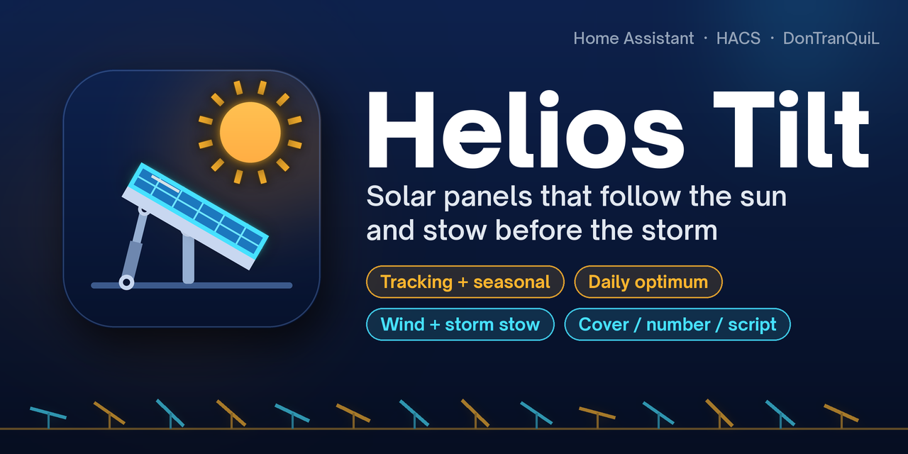
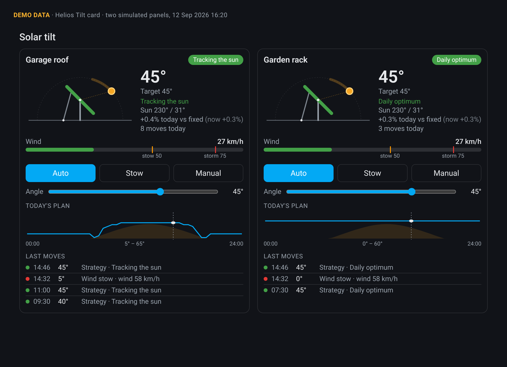

<div align="center">



<br>

**Automatic tilt control for solar panels on linear actuators. Helios Tilt works out where the sun is, picks the best angle for each panel, and drives your actuator to it. When the wind picks up it stows the panels first.**

[](https://my.home-assistant.io/redirect/hacs_repository/?owner=DonTranQuiL&repository=helios-tilt&category=integration)
[](https://my.home-assistant.io/redirect/config_flow_start/?domain=helios_tilt)

[](https://github.com/DonTranQuiL/helios-tilt/releases)
[](https://hacs.xyz)
[](https://www.home-assistant.io/)
[](LICENSE)

[](https://github.com/DonTranQuiL/helios-tilt/actions/workflows/pytest.yml)
[](https://github.com/DonTranQuiL/helios-tilt/actions/workflows/hass-ci.yml)
[](https://github.com/DonTranQuiL/helios-tilt/actions/workflows/hassfest.yaml)
[](https://github.com/DonTranQuiL/helios-tilt/actions/workflows/hacs.yaml)
[](https://github.com/DonTranQuiL/helios-tilt/actions/workflows/codeql.yml)
[](https://github.com/astral-sh/ruff)
[](https://discord.gg/qaHPTTKHae)
[](https://ko-fi.com/DonTranQuiL)

[How the angle is chosen](#how-the-angle-is-chosen) · [Safety](#safety) · [Install](#installation) · [Wiring](#wiring-examples) · [Entities](#entities) · [Actions](#actions) · [Card](#dashboard-card) · [Try it with a dummy cover](#try-it-without-hardware) · [Troubleshooting](#troubleshooting) · [Docs site](https://dontranquil.github.io/helios-tilt/)

</div>

> [!WARNING]
> **Beta.** v0.1.0 is the first public release. Watch the panels the first few days, and read the [mechanical safety](#mechanical-safety) section before you connect real hardware.

## Highlights

| | |
| --- | --- |
| ☀️ **Real sun position** | The NOAA solar position algorithm with refraction, computed locally. No cloud service, no extra Python packages. |
| 📐 **Four strategies** | Fixed annual optimum, a seasonal curve, one move per day to the day's optimum, or full sun tracking with a cloudy-day mode and a night park position. |
| 🌬️ **Wind first** | Stows on wind speed or gusts from your weather entity and/or your own anemometer, in any unit. It resumes only after a calm period, and storm mode latches for hours. |
| ❄️ **Weather positions** | Optional snow-shedding, heavy-rain and frost angles. |
| 🔩 **Any actuator** | Drives a `cover`, a `number`/`input_number`, or a script. Linear or calibration-table mapping, inverted actuators, position or inclinometer feedback, or an open-loop estimate from the travel time. |
| 🛡️ **Gentle on the hardware** | Never commands an actuator that is moving. Minimum time between moves, deadband and hysteresis, and a repair notice when an actuator gets stuck. |
| ✋ **Respects your hands** | Move a panel by hand and automatic control pauses for an hour. |
| 🃏 **Dashboard card included** | A side view of each panel with the sun, a wind gauge, Auto/Stow/Manual buttons, an angle slider, today's plan and the last moves. It loads automatically. |

<div align="center">

<br><sub>The bundled card, rendered from <b>demo data</b> (two simulated panels).</sub>
</div>

## How the angle is chosen

Every minute, and whenever the weather or an actuator changes, Helios Tilt runs one decision round for each panel. The first rule that applies wins:

| Priority | Rule | Panel goes to |
| --- | --- | --- |
| 1 | **Storm mode** or **wind stow** | stow angle (immediately, ignoring the minimum interval) |
| 2 | Stowed with the **Stow** action | stow angle |
| 3 | **No valid wind data** (at start-up, or stale) | stays where it is; it stays stowed if the last wind was high |
| 4 | **Snow / heavy rain / frost** (if enabled) | snow / rain / frost angle |
| 5 | **Manual mode** | your manual angle |
| 6 | **Paused** after a move by hand | stays where it is |
| 7 | **Automatic control off** | stays where it is |
| 8 | **Strategy** | see below |

**Strategies** (per panel; the mode select can override it):

- **Fixed:** the best fixed angle for the year at your location. It uses a clear-sky model weighted by irradiance and is worked out once at start-up.
- **Seasonal:** a smooth curve between your *winter* and *summer* angle, peaking at the solstices. The *season weight* leans it: 50 is a plain cosine, higher stays steep longer.
- **Daily:** each day, the single angle that collects the most clear-sky energy that day. One move in the morning, then rest. This is the default and works well with slow actuators.
- **Tracking:** follows the sun's projected elevation, a touch flatter than pointing straight at it to keep more sky light. Under heavy cloud (above the cloud threshold) it goes to the flat *diffuse* angle, which catches more scattered light. At night it parks.

The raw angle is clamped to the panel's soft limits and rounded to the **step** (5° by default). **Hysteresis** keeps the current step while the raw angle hovers around a boundary. Changes smaller than the **deadband** are skipped, and normal moves wait for the **minimum interval** (5 min). Safety moves and your own actions (mode, angle, resume) go through immediately.

**Axis.** A *tilt* rack leans toward its azimuth (0° = flat, 180 = south-facing). A *roll* tracker is a single-axis tracker; its azimuth is the direction of positive tilt (axis + 90°), so negative angles tilt the other way. The same math handles both.

The **estimated gain** sensor compares today's modelled clear-sky energy at the angles the panel actually held with the same panel fixed at its annual optimum (rounded to the panel's step, within its limits). Only time the panel follows its strategy counts: wind, storm and manual stows, snow/rain/frost positions, manual mode, cloudy-day diffuse parking and data freezes are left out of both sides and reported in the `excluded_minutes` attribute. The `instant_gain` attribute shows the same comparison for this moment only. Over a clear day, tracking and the daily optimum model at or above fixed. With 5° steps they can trail it by a few tenths of a percent, mostly around the equinoxes, when a tilt-only rack gains little anyway (often under 1%). The gain is largest near the solstices. Give a panel a PV power sensor and peak power, and you also get **PV actual vs model**, which compares real output with the clear-sky model.

## Safety

- **Wind stow:** wind is the highest of the weather entity's `wind_speed`, its `wind_gust_speed`, and your wind sensor, all converted to km/h. At the **stow speed** (default 50 km/h) every panel goes to its stow angle at once.
- **Resume:** only after the wind has stayed at or below the **resume speed** (35 km/h) for the **calm time** (10 min). A gust in between restarts the timer.
- **Storm mode:** at the **storm speed** (75 km/h), or with the `stow` action and `storm: true`, the site latches into storm mode. It stays on for the **hold time** (6 h) after the last strong wind. Set the hold time to 0 to clear it only by hand, with *Resume auto*.
- **Missing data:** without fresh wind data (older than 120 min, or unavailable) panels freeze where they are. If the last reading was windy, they stay stowed. Nothing moves after a restart until valid wind data has arrived.
- **Actuator protection:** never sends a command while a cover reports opening or closing, or while an open-loop move is still running. If an actuator doesn't reach its target within 1.5x its travel time (+30 s), a repair notice appears. It clears itself when the actuator arrives.

The config flow refuses a setup without a wind source.

### Mechanical safety

> [!CAUTION]
> Helios Tilt is software. It can't see your mount, and Home Assistant can crash, lose Wi-Fi or be updated at the wrong moment.
> - Use actuators with **hardware end stops** or limit switches, and fuse their supply.
> - Set the soft limits inside the mechanical range, and **test the stow angle** for your mount and local wind loads.
> - For storm protection that never depends on Home Assistant, add a local fallback in the actuator controller, such as an ESPHome anemometer that stows on its own.
> - Keep people and pets clear of moving mounts. Use this integration at your own risk (MIT licence, no warranty).

## Installation

### HACS (recommended)

1. Click **Open in HACS** above, or add `https://github.com/DonTranQuiL/helios-tilt` as a custom repository (type *Integration*).
2. Download **Helios Tilt**. For the beta, enable *Show beta versions* on the repository first.
3. Restart Home Assistant.
4. **Settings → Devices & services → Add integration → Helios Tilt.**

### Manual

Copy `custom_components/helios_tilt` into your `config/custom_components/` folder and restart.

### Setup

1. **Site:** a name, the location (defaults to your Home Assistant location), and a **weather entity** and/or a **wind speed sensor**.
2. **First panel:** the actuator, axis, azimuth, soft limits, step and strategy. Collapsed sections hold the mapping and feedback, the positions (stow, night, diffuse, snow, rain, frost, and the seasonal winter/summer angles) and the optional PV comparison.
3. To add more panels: on the integration page, choose **⋮ → Add panel**. Each panel's **⋮ → Reconfigure** changes it later.
4. Under **Configure** on the site you'll find the thresholds: wind speeds, calm time, storm hold, stale-data time, weather positions, cloud threshold, minimum interval, manual pause, deadband and hysteresis. **Reconfigure** on the site changes the location and weather sources.

### Actuator mapping

Helios Tilt thinks in panel angles; your actuator thinks in positions.

- **Linear:** *position at minimum angle* and *position at maximum angle*. For a cover these are usually 0 and 100. Swap them for an actuator that extends to flatten the panel.
- **Calibration table:** for the non-linear geometry of a strut pushing a hinged panel. Measure a few points and enter `angle:position` pairs, for example `0:0, 15:22, 30:47, 45:75, 60:100`. Positions must rise (or fall) steadily with the angle.

**Feedback:** a separate sensor reporting the actuator position or the panel angle (an inclinometer) is best. Without one, a cover's `current_position` is used. Without either (a `number` or a script), Helios estimates the position from the full-stroke **travel time**. After a power cut, tell it the real angle with `helios_tilt.calibrate`.

## Wiring examples

<details>
<summary><b>ESPHome: linear actuator on two relays (time-based cover)</b></summary>

```yaml
switch:
  - platform: gpio
    pin: GPIO26
    id: extend
    interlock: [retract]
    restore_mode: ALWAYS_OFF
  - platform: gpio
    pin: GPIO27
    id: retract
    interlock: [extend]
    restore_mode: ALWAYS_OFF

cover:
  - platform: time_based
    name: "Panel actuator"
    open_action:
      - switch.turn_on: extend
    open_duration: 45s
    close_action:
      - switch.turn_on: retract
    close_duration: 45s
    stop_action:
      - switch.turn_off: extend
      - switch.turn_off: retract
```

Pick `cover.panel_actuator` as the actuator and set the travel time to 45 s. A time-based cover only estimates its position, so an inclinometer is a good addition:

```yaml
i2c:
sensor:
  - platform: mpu6050
    address: 0x68
    accel_x:
      id: ax
      internal: true
    accel_z:
      id: az
      internal: true
  - platform: template
    name: "Panel angle"
    unit_of_measurement: "°"
    update_interval: 5s
    lambda: 'return atan2(id(ax).state, id(az).state) * 180.0 / PI;'
```

Use `sensor.panel_angle` as the feedback sensor, with *Feedback reports: Panel angle*.
</details>

<details>
<summary><b>ESPHome: stepper or servo as a number</b></summary>

```yaml
stepper:
  - platform: a4988
    id: actuator
    step_pin: GPIO18
    dir_pin: GPIO19
    max_speed: 400 steps/s

number:
  - platform: template
    name: "Panel actuator target"
    min_value: 0
    max_value: 100
    step: 1
    optimistic: true
    set_action:
      - stepper.set_target:
          id: actuator
          target: !lambda "return x * 40;"   # 100 % = 4000 steps
```

Pick `number.panel_actuator_target`. Helios estimates the travel from the travel time, or reads a feedback sensor if you have one.
</details>

<details>
<summary><b>MQTT cover</b></summary>

```yaml
mqtt:
  cover:
    - name: "Panel actuator"
      unique_id: panel_actuator
      command_topic: "solar/panel1/cmd"
      set_position_topic: "solar/panel1/set"
      position_topic: "solar/panel1/position"
      position_open: 100
      position_closed: 0
      payload_stop: "STOP"
```
</details>

<details>
<summary><b>Script (anything else)</b></summary>

A script actuator is called with `angle`, `position` and `panel` variables:

```yaml
script:
  tilt_shed_panel:
    fields:
      angle: {}
      position: {}
      panel: {}
    sequence:
      - action: rest_command.shed_actuator
        data:
          target: "{{ position | round(0) }}"
```
</details>

## Try it without hardware

Make a dummy panel with a template cover backed by a helper:

1. **Settings → Devices & services → Helpers → Create helper → Number:** name `Helios test position`, min 0, max 100, step 1.
2. Add this template cover to `configuration.yaml` and restart:

```yaml
template:
  - cover:
      - name: "Helios test panel"
        unique_id: helios_test_panel
        position: "{{ states('input_number.helios_test_position') | int(0) }}"
        set_cover_position:
          - action: input_number.set_value
            target:
              entity_id: input_number.helios_test_position
            data:
              value: "{{ position }}"
```

3. Add Helios Tilt with your weather entity, and pick `cover.helios_test_panel` as the actuator.
4. Watch it move: change the strategy, use the card's buttons, drag the helper (manual detection pauses automatic control), or set a test wind sensor above the stow speed.

To test the open-loop path, use the `input_number` helper itself as the actuator.

## Entities

One device per panel. Entity IDs follow the panel name, here `garden`:

| Entity | Description |
| --- | --- |
| `sensor.garden_target_angle` | Where the panel should be. Attributes: mode, strategy, reason, detail, safety state, limits, sun position, fixed optimum, `today_curve`, `sun_path` |
| `sensor.garden_current_angle` | Where it is. Attributes: `source` (feedback / cover / estimate), `moving`, `commanded`, `stuck` |
| `select.garden_mode` | `auto`, `manual`, `fixed`, `seasonal`, `daily`, `tracking` |
| `number.garden_manual_angle` | Set an angle; switches the panel to manual |
| `switch.garden_automatic_control` | Off: no strategy moves (safety still stows) |
| `binary_sensor.garden_storm_mode` | Storm mode latched |
| `binary_sensor.garden_wind_stow` | Stowed for wind (or by hand). Attributes: wind speed and thresholds in km/h |
| `sensor.garden_last_move` | Reason of the last move, with the last 10 moves in `history` |
| `sensor.garden_moves_today` | Commanded moves today |
| `sensor.garden_estimated_gain` | Modelled clear-sky energy today vs the fixed annual optimum, while following the strategy, in % (`instant_gain` for right now) |
| `sensor.garden_pv_actual_vs_model` | Only with a PV power sensor and peak power: actual output as % of the clear-sky model |

Every move also writes a **logbook** entry ("moved to 45°: Daily optimum") and fires a `helios_tilt_move` event with `panel`, `angle`, `reason` and `detail`.

## Actions

Target panels by entity or device; without a target, an action applies to every panel.

| Action | Fields | What it does |
| --- | --- | --- |
| `helios_tilt.set_tilt` | `angle` | Manual mode at this angle (clamped to the limits) |
| `helios_tilt.stow` | `storm` (optional) | Stow until resumed. With `storm: true`, also latch storm mode for the site |
| `helios_tilt.resume_auto` | – | Clear stow, manual mode, the manual pause and storm mode |
| `helios_tilt.set_mode` | `mode` | `auto`, `manual` or a strategy |
| `helios_tilt.calibrate` | `angle` | Tell Helios the real angle without moving (needs a target) |

## Dashboard card

The card is registered automatically. Add it from the card picker (**Helios Tilt**), or with YAML:

```yaml
type: custom:helios-tilt-card
title: Solar tilt
# entities: empty = every panel
entities:
  - sensor.garden_target_angle
show_wind: true
show_controls: true
show_curve: true
show_history: true
history_count: 4
```

It follows your theme, switches to one column on narrow screens, and has a visual editor. Languages: English and Dutch.

## Automation examples

<details>
<summary><b>Notify when storm mode starts</b></summary>

```yaml
automation:
  - alias: "Solar panels in storm mode"
    triggers:
      - trigger: state
        entity_id: binary_sensor.garden_storm_mode
        to: "on"
    actions:
      - action: notify.mobile_app_phone
        data:
          message: "Solar panels stowed: {{ state_attr('binary_sensor.garden_wind_stow', 'wind_speed') }} km/h"
```
</details>

<details>
<summary><b>Stow on a severe weather warning</b></summary>

```yaml
automation:
  - alias: "Stow panels on a weather warning"
    triggers:
      - trigger: state
        entity_id: binary_sensor.weather_warning
        to: "on"
    actions:
      - action: helios_tilt.stow
        data:
          storm: true
```
</details>

<details>
<summary><b>Flat for cleaning, then back to automatic</b></summary>

```yaml
script:
  clean_panels:
    sequence:
      - action: helios_tilt.set_tilt
        target:
          entity_id: sensor.garden_target_angle
        data:
          angle: 0
      - delay: "01:00:00"
      - action: helios_tilt.resume_auto
        target:
          entity_id: sensor.garden_target_angle
```
</details>

## Troubleshooting

| Symptom | Check |
| --- | --- |
| Panels don't move after a restart | They wait for valid wind data. `sensor.<panel>_target_angle` → attribute `safety` shows `startup` or `stale`. Check that the weather entity has `wind_speed`, and that a wind sensor reports a number with a unit. |
| Stuck at "Holding: no wind data" | The wind source hasn't updated for 120 min. Raise the stale time in **Configure**, or add a local wind sensor. |
| "Paused after manual move" | Something moved the actuator without Helios: a manual move, a slow cover reporting odd positions, or a wrong mapping. Check the mapping and the travel time, or lower the manual pause. |
| Repair "actuator did not reach its angle" | Power, end stops, or a travel time set too short. The notice clears when the panel arrives. |
| Angles are mirrored | Swap *position at minimum/maximum angle*, or use a falling calibration table. |
| Too many moves | Use a larger step, deadband or minimum interval, or the *daily* strategy. |
| Card not showing | Hard-refresh the browser. The card URL carries a version hash, so new versions load by themselves. |

Debug logging:

```yaml
logger:
  logs:
    custom_components.helios_tilt: debug
```

Diagnostics (**⋮ → Download diagnostics**) include the config and live state; latitude and longitude are redacted.

## Roadmap

- Learning from PV output: adjusting the model with the actual-vs-model ratio.
- Forecast-aware daily planning (cloudy day ahead → flatter).
- Shading horizon per panel.

## Contributing

Issues and PRs are welcome. Run `ruff check .` and `pytest`; the card is tested in headless Chrome when it is installed.

<div align="center"><sub>Made by <a href="https://github.com/DonTranQuiL">DonTranQuiL</a> · MIT licence</sub></div>
